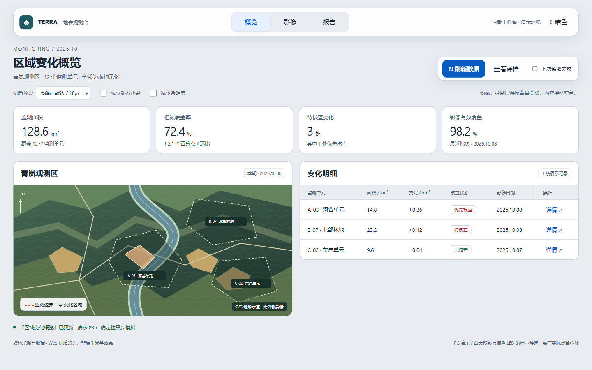
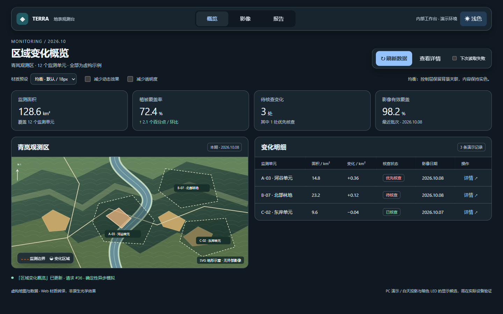
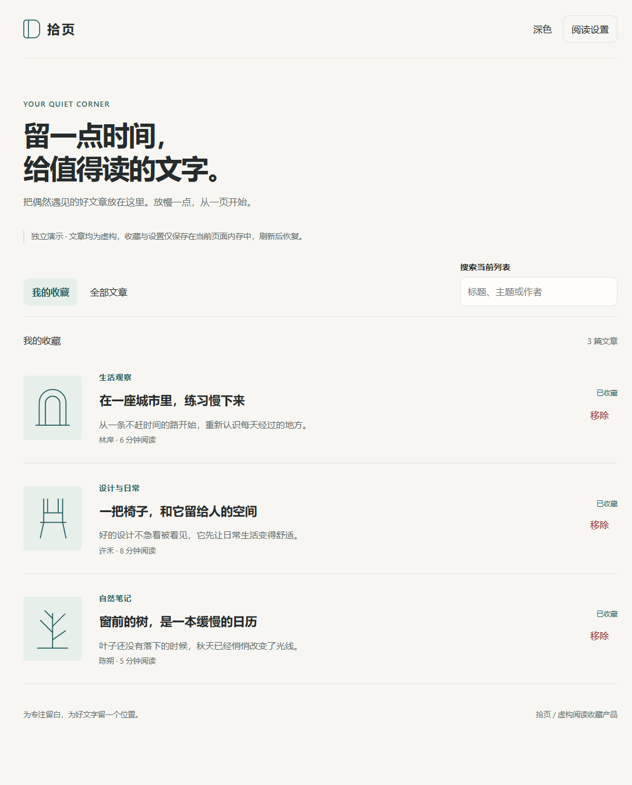
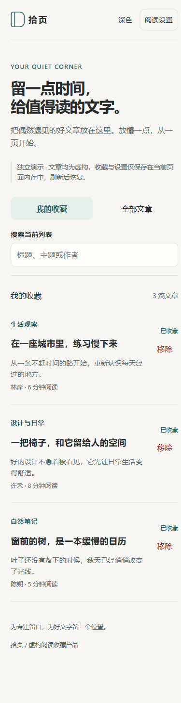

# 设计选择与验证记录

日期：2026-10-10。此处记录独立虚构产品的验证，不代表江西项目或所有Apple平台已验收。

## 通用思想的取舍

以Apple的八项设计原则作为判断框架，凝练任务与层级、文字/色彩/图标、导航/搜索、输入/反馈、控制权/恢复、包容性、平台适配、material/motion/layout。主要入口保留决策规则，详细来源与案例放到references；不把一个行业、桌面结构或固定数值当成通用设计。

两种Web产品分别保留自己的品牌、密度和核心流程：数据工作台强调比较、异步状态与非模态详情；阅读收藏强调正文节奏、返回上下文、撤销和表单纠错。官方Landmarks及Codrops实验仅做来源分析，未编译或运行其产品，未将它们的效果或性能算入本次测试。

## 基线与独立应用

先由独立agent制作未提供skill的数据工作台，再由另一个agent阅读skill制作对照原型。真实浏览器检查发现基线的刷新按钮与SVG symbol重复ID，事件没有绑定到用户实际点击的按钮；系统减少透明度匹配后仍保留透明blur。应用示例通过实际点击/busy/完成检查、唯一ID检查及系统/手动实色检查。

基线已有内容与控制层分离、基本动效、主题、减少动态效果和请求版本控制，不能把这些列为skill新增收益。对照任务还包含三材质比较等新增要求，因此本轮不是统计意义的因果实验。

另做通用设计决策基线：阅读产品在没有本skill的情况下已给出正文排版、标签、撤销、输入保留、主题语义与辅助功能的正确建议。应用skill后再制作阅读原型，并以浏览器验证实际行为。这证明本轮应用能覆盖另一类产品；不证明这些决策只有该skill才能产生。

## 材质候选与选择

在相同视口、主题、前台Edge上对比三个示例预设。数值为文字/透明表面分别与黑白底色合成后的次要文本最低对比；不包含任意真实图片、渐变和混合模式，不是完整WCAG认证。

| Web预设 | 浅色最低对比 | 深色最低对比 | 取舍 |
|---|---:|---:|---|
| 轻透 | 2.61:1 | 3.26:1 | 次要普通文字未达到4.5:1，保留为对照候选，不作为推荐默认 |
| 均衡 | 5.08:1 | 6.00:1 | 文字清楚且保留背景关联，选择为数据示例默认 |
| 实色 | 6.37:1 | 8.73:1 | 可读性强，作为减少透明度/降级路径 |

本轮均衡使用浅色alpha 0.90、深色alpha 0.88与18px blur；是这个示例的实测结果，不是Apple要求或其他背景的通用值。阅读示例使用不同的暖色内容与局部反馈材质，没有套用仪表盘结构。

## 连续浏览器操作

Windows，Node 24.15.0，Playwright 1.58.2；真实窗口Edge 154.0.4258.53，同时用独立Chromium 145.0.7632.6 headless做可复现回归。

| 演示 | 已通过的验收 |
|---|---|
| 数据工作台 | 14组：26次异步快切、重复刷新、错误/重试、详情Esc/回焦、12次运动中断、真实按下反馈、动态偏好运行时变化、透明度/对比/实色降级、强制颜色、双期图片比例、双主题三材质、窗口/放大/遮挡及帧间隔采样 |
| 阅读收藏 | 9组：唯一ID、窄视口与命中尺寸、搜索范围/空态/返回、连续移除与逐次撤销恢复排序、24次阅读往返、阅读内收藏、原生模态键盘/Esc/取消、输入纠错/保存忙碌状态、字号/主题/偏好/放大 |

两个演示在headed Edge和headless Chromium均通过，未捕获页面异常、console error或外部业务请求。截图还人工检查了明暗材质、详情、影像、放大重排、阅读列表/正文与表单错误状态。保存原始通过报告：[数据Edge](browser-report.json)、[数据Chromium](chromium-report.json)、[阅读Edge](reader-report.json)、[阅读Chromium](reader-chromium-report.json)。

数据示例每种材质连续操作采样约2201ms：轻透313个间隔，均衡/实色各317个；三者p95均为7ms，超过50ms均为0，最大间隔分别34.7/7.2/7.1ms。此测量是rAF调度间隔，受刷新率、机器负载与窗口状态影响；不是GPU帧时间、长时间性能保证或材质之间显著差异的证明。选择均衡主要基于本次可读性与视觉层级。

## 验收发现并修复的问题

- 均衡浅色材质早期次要文字对比不足，调整后达到本示例的保守门槛。
- CSS放大后地图图例与署名重叠；改为同一布局流并增加真实矩形相交断言，复验通过。
- 帧采样在页面停止绘制时可能无限等候；增加Node侧12秒超时。注入永不完成的采样副本后，脚本按预期exit 1并保存失败报告，未把超时算通过。
- 阅读标题按钮在390×844下只有约27.35 CSS px高；扩大实际命中区域至本示例44px目标，真实窗口复验通过。
- 原生dialog的Tab可以进入浏览器工具栏，页面activeElement此时为body；测试初稿误认为焦点泄漏。复现后按原生行为校验，另确认背景页面按钮无法获得焦点，没有增加自制困焦来屏蔽浏览器功能。

## 脚本与发布检查

新增4项对比计算单测通过；既有两skill的31+9项Python单测通过。skill结构校验通过，18条JSONL样例格式/ID检查通过；样例是人工行为评估输入，不能将其格式检查说成18项行为全部通过。CI新增两个独立浏览器回归及失败证据保存。

## 未验证范围

未验证原生SwiftUI、Safari/WebKit、实际iPhone/iPad、真实读屏/辅助输入、触觉硬件、RTL完整流程、低端GPU长时间负载、投影/LED实机。无blur使用示例强制降级入口，未运行真正不支持blur的旧浏览器。200%压力测试使用CSS zoom与等效CSS视口，未覆盖原生浏览器缩放的一切行为。阅读模型刷新即恢复，未连接服务端、账户、邮件或浏览器历史路由。接入其他产品后仍需按真实平台、内容和业务流程验收。
